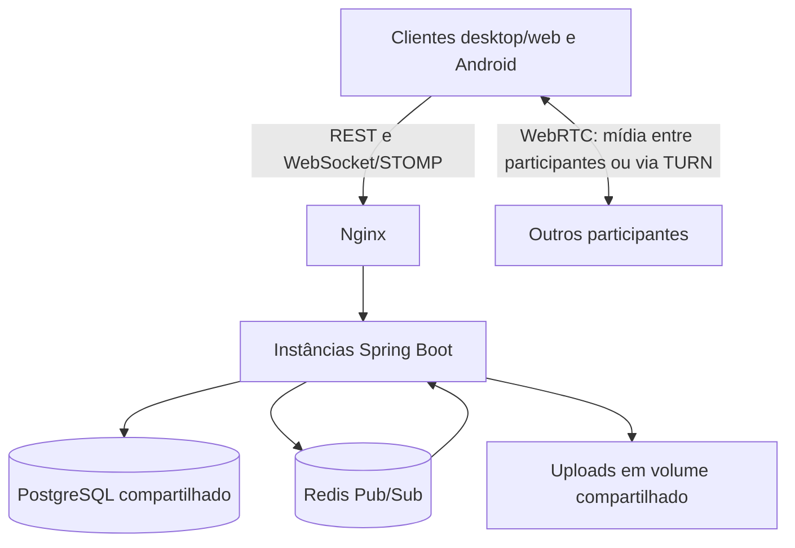

# SamusChat — estabilidade, alta demanda e estratégia de evolução

Data: 31/10/2026. Análise estática do repositório e pesquisa em fontes oficiais. Não foram executados testes de carga nesta análise nem verificada a infraestrutura em produção. As configurações descritas representam o que está versionado, não confirmação de implantação.

## 1. Parecer executivo

O SamusChat possui uma base adequada para evoluir: backend Spring Boot/Java 21, PostgreSQL, histórico paginado, WebSocket/STOMP, Redis para distribuição de eventos, chamadas WebRTC e controles de qualidade de mídia. Não há evidência suficiente nesta avaliação para afirmar quantos usuários simultâneos ele suporta.

A principal recomendação é **medir e limitar o trabalho por usuário, mensagem e chamada antes de ampliar a infraestrutura**. As prioridades são reduzir consultas e polling, tirar tarefas secundárias do envio de mensagens, recuperar eventos perdidos, controlar o consumo do cliente e comprovar o funcionamento sob falhas.

Três processos do backend ajudam a distribuir requisições, mas não triplicam automaticamente a capacidade: todos compartilham PostgreSQL, Redis e armazenamento. No Compose analisado, também compartilham o domínio de falha do host. Para chamadas, o limite mais próximo pode ser o aparelho e sua conexão de upload, mesmo com o servidor ocioso.

## 2. O que significa estabilidade

É necessário distinguir quatro problemas:

| Dimensão | Exemplo | Como medir |
| --- | --- | --- |
| Fluidez do cliente | Digitação e rolagem travam | Tempo de quadro, tarefas longas, CPU, memória e ANRs no Android |
| Latência do serviço | Mensagem demora a confirmar | p50, p95 e p99 de envio, leitura e entrega ao destinatário |
| Disponibilidade | Login ou chat ficam indisponíveis | Taxa de sucesso, duração das interrupções e recuperação |
| Qualidade da mídia | Voz corta e imagem congela | RTT, jitter, perda, congelamentos, quadros descartados e tempo de codificação |

Milhares de contas cadastradas não equivalem a milhares de pessoas conectadas. Uma conexão ociosa tem custo diferente de enviar mensagens, baixar anexos ou transmitir tela. A capacidade precisa ser publicada junto com o cenário, hardware, rede, tamanho do histórico e critérios de aprovação.

## 3. Arquitetura atual e tráfego

O diagrama resume o desenho versionado. A disponibilidade de TURN depende da configuração e da infraestrutura efetivamente contratada e implantada.

| Tráfego | Comportamento observado | Efeito do crescimento |
| --- | --- | --- |
| Texto | Persistência em PostgreSQL; eventos distribuídos via Redis e broker STOMP local | Escritas, consultas e quantidade de destinatários aumentam o custo |
| Histórico | Canais paginados, até 100 itens; privadas em páginas de 50 | Evita carregar toda a conversa, mas páginas profundas e consultas auxiliares precisam de medição |
| Contatos e recuperação | Desktop atualiza contatos a cada 15 s e sincroniza conversa a cada 3 s quando o tempo real está indisponível | Falha coletiva pode transformar conexões leves em muitas requisições HTTP |
| Anexos | Arquivos atendidos pelo backend, com volume compartilhado no Compose | Downloads disputam rede e recursos com a API; replicar em outros hosts exige armazenamento acessível a todos |
| Voz e tela em sala | Um peer WebRTC por outro participante; sala limitada a seis | Crescem upload, conexões, processamento e recepção em cada cliente |

Em uma malha completa, N participantes formam N × (N − 1) / 2 pares. Com seis pessoas são 15 pares, cinco conexões por pessoa. Isso não significa que cada conexão carregue todos os tipos de mídia continuamente; depende das trilhas ativas.

Exemplo de orçamento, não benchmark: uma tela de 2 Mbit/s enviada a cinco receptores consome aproximadamente 10 Mbit/s de upload do transmissor, além dos demais fluxos e overhead. Um SFU pode receber uma publicação e encaminhá-la aos interessados, transferindo o custo de distribuição para o servidor de mídia. Simulcast e múltiplas camadas também têm custo e precisam entrar na conta.

## 4. Evidências e riscos sob alta demanda

| Ponto | Evidência no código/configuração | Consequência provável e ação |
| --- | --- | --- |
| Banco compartilhado | Produção configura Hikari com até 20 conexões por instância | Três instâncias podem abrir até 60 conexões de aplicação. Medir espera pelo pool e consultas; aumentar threads não resolve banco saturado |
| Consultas por mensagem | `MessageMapper.toResponse` consulta usuário para obter avatar | Há padrão de consulta por item no histórico. O número real depende do cache/contexto de persistência. Medir SQL e substituir por projeção, lote ou cache limitado |
| Notificação no envio | `MessageService` busca membros do servidor e chama a estratégia dentro da transação | O custo cresce com os membros. Se a estratégia usar integração externa, ela pode alongar a transação. Separar notificação em processamento posterior ao commit |
| Eventos sem replay | `MessageBroadcaster` publica depois do commit; Redis Pub/Sub distribui eventos | Persistência e publicação não são atômicas. Uma queda entre ambas pode deixar mensagem salva sem evento ao vivo. Recuperar por cursor e considerar outbox |
| Redis indisponível | Publicação de canal tem fallback de entrega local | Pode haver entrega apenas a clientes da mesma instância. Tratar como degradação e reconciliar pelo histórico |
| Reconexão simultânea | Desktop tem reconexão fixa de 3 s e fallback periódico | Muitos clientes podem reconectar juntos. Usar atraso exponencial com variação aleatória e limitar requisições em voo |
| Proteção por IP | Nginx limita `/api/` a 30 requisições/minuto por IP, com burst 10 | Redes compartilhadas e fallback podem sofrer 429 antes de esgotar CPU. Separar rotas e medir limites por conta/IP conforme o fluxo |
| Distribuição de sockets | Nginx usa `ip_hash` para WebSocket/SockJS | Usuários atrás do mesmo NAT podem concentrar sessões em uma instância. Medir distribuição antes de trocar afinidade necessária ao fallback |
| Disponibilidade da infraestrutura | Compose tem um PostgreSQL, um Redis mestre, uma réplica e um Nginx | Réplica Redis não configura failover automático. Não há alta disponibilidade entre hosts demonstrada por esse arquivo |
| Memória Redis | Limite de 512 MB com `noeviction` | Ao atingir o teto, operações que precisam de memória podem falhar. Monitorar uso, recusas e crescimento de dados; o limite não informa a capacidade de usuários |
| Limite de borda | `worker_connections 1024` por worker no Nginx | Considerar sockets cliente e upstream, descritores e quantidade de workers. Não interpretar como 1024 usuários totais |
| Health check superficial | `/health` do Nginx responde 200 diretamente | Confirma a borda, mas não o funcionamento do chat. Monitorar também API, banco, Redis e uma transação sintética |

Pontos positivos: índices de mensagens e participantes já aparecem nas migrações; há limites de mensagem e buffers WebSocket, shutdown gracioso e readiness incluindo banco/Redis. Esses controles reduzem risco, mas precisam ser exercitados com clientes lentos, quedas e concorrência.

**Comportamento esperado sob sobrecarga, ainda não medido:** filas e espera pelo banco podem elevar latência; polling e reconexão podem ampliar a pressão durante incidentes; limites podem gerar 429; salas podem perder fluidez por CPU/upload do cliente. Não é possível ordenar definitivamente esses gargalos sem teste representativo.

## 5. O que os testes existentes comprovam

O [registro de estabilidade de mídia](ESTABILIDADE_MIDIA_2026-10-20.md) documenta correções de negociação, sequência de áudio, redução de captura e escolha de codec, além de uma janela contínua de aproximadamente um minuto aprovada. O próprio documento limita a conclusão à janela observada e registra cobertura adicional de sala e sessão prolongada pendente naquele momento.

O teste `samuschat-desktop/tests/room-soak.spec.ts` cobre três participantes, voz, tela, progressão de mídia e liberação de captura. Sua duração padrão é 30 segundos, configurável até 30 minutos. A existência do teste não comprova sua execução nesta análise nem substitui milhares de conexões reais, aparelhos físicos ou redes degradadas.

Não foi identificado nas buscas direcionadas um resultado de carga que estabeleça capacidade de produção. Isso deve ser tratado como **capacidade não determinada**, sem inventar um número máximo.

## 6. Por que WhatsApp e Discord conseguem atender tanta gente

Nenhum aplicativo é imune a indisponibilidade, lentidão ou falhas. O objetivo de engenharia é limitar o impacto de uma falha e recuperar o serviço rapidamente. Também é preciso distinguir estabilidade dos servidores da fluidez no aparelho.

**WhatsApp:** a documentação de múltiplos dispositivos descreve identidades por dispositivo e distribuição de mensagens aos dispositivos envolvidos. Isso mostra que sincronização exige um protocolo próprio, não apenas um socket aberto. Para chamadas, a Meta descreve conexão direta e retransmissão; a opção de proteger o IP usa servidores intermediários. São escolhas entre custo, conectividade, privacidade e latência. Não há base nessas fontes para copiar uma capacidade por servidor ou uma arquitetura interna completa. [Meta: múltiplos dispositivos](https://engineering.fb.com/2021/07/14/security/whatsapp-multi-device/), [Meta: chamadas](https://engineering.fb.com/2023/11/08/security/whatsapp-calls-enhancing-security/).

**Discord:** as publicações técnicas descrevem separação entre sinalização e SFU, acompanhamento de saúde/carga dos servidores de voz e evolução da distribuição de eventos de grandes comunidades. Para o SamusChat, a lição é separar mídia de API e controlar o custo de distribuir um evento a muitos destinos. Os textos são retratos das soluções publicadas em suas datas, não um inventário completo da infraestrutura atual. [Discord: voz e SFU](https://discord.com/blog/how-discord-handles-two-and-half-million-concurrent-voice-users-using-webrtc), [Discord: grandes comunidades](https://discord.com/blog/maxjourney-pushing-discords-limits-with-a-million-plus-online-users-in-a-single-server).

**Skype:** é uma referência histórica. O produto de consumo foi aposentado em 5 de maio de 2025, segundo a Microsoft. Skype for Business é outro produto e sua arquitetura não deve ser usada como descrição do Skype de consumo. Para decisões novas, as referências de WebRTC e Discord são mais diretamente comparáveis ao projeto. [Microsoft: aposentadoria do Skype](https://support.microsoft.com/en-us/skype/skype-is-retiring-in-may-2025-what-you-need-to-know).

| Tema | SamusChat observado | Estratégia aplicável |
| --- | --- | --- |
| Distribuição de eventos | Redis para instâncias; broker local | Limitar destinatários e reconciliar eventos perdidos |
| Salas | Malha, máximo de seis | Manter salas pequenas e avaliar SFU quando medições justificarem |
| Histórico | PostgreSQL paginado | Otimizar consultas e usar cursor antes de considerar banco distribuído |
| Resiliência | Réplicas do backend no Compose | Isolar falhas, automatizar recuperação e testar restauração |
| Recursos no aparelho | Captura e reprodução WebRTC com ajustes próprios | Medir CPU, temperatura, memória e adaptar qualidade durante a sessão |

O Discord descreve evolução de armazenamento para escala de trilhões de mensagens. Essa escala não justifica trocar agora o PostgreSQL do SamusChat: a decisão deve seguir volume e gargalos demonstrados. [Discord: armazenamento](https://discord.com/blog/how-discord-stores-trillions-of-messages).

## 7. Métodos que melhor combinam com um app leve e rápido

### Prioridade 1 — reduzir trabalho e tornar falhas visíveis

1. Instrumentar latência p95/p99, erros, conexões, espera pelo pool, consultas por operação, CPU, heap, pausas de GC e filas. Separar 429 esperado de falha interna.
2. Reduzir consultas repetidas de avatar/permissões; medir planos com `EXPLAIN ANALYZE` em dados representativos. Preservar autorização e coerência dos dados ao introduzir cache.
3. Retirar notificações externas do caminho crítico. Usar fila limitada, retries com espera e deduplicação; quando a entrega precisar sobreviver a reinícios, usar outbox persistente.
4. Adotar reconexão com variação aleatória, backoff e reconciliação por cursor. Evitar polling sobreposto e reduzir atividade em segundo plano sem comprometer chamadas e notificações.
5. Definir limites por rota e usuário, considerando escolas, empresas e redes móveis com IP compartilhado. Responder com orientação de retry e evitar ciclos agressivos após 429.

### Prioridade 2 — limitar memória e preservar a interface

6. Manter histórico e cache do cliente com limites explícitos; virtualizar listas quando o volume medido justificar. Não acumular indefinidamente elementos de mensagem, blobs ou anexos decodificados.
7. Carregar miniaturas e mídia sob demanda; cancelar requisições obsoletas, liberar object URLs, tracks e contextos de áudio. Medir recursos após entrar e sair de chamadas repetidas vezes.
8. Usar orçamento de pixels, fps e bitrate por aparelho/rede. Reduzir primeiro a qualidade da tela para preservar a voz; validar aquecimento e consumo em sessões de horas.
9. Aplicar contrapressão: filas limitadas e descarte de quadros obsoletos de mídia. Mensagens persistentes precisam de confirmação e recuperação; não devem seguir a política de descarte de vídeo.

### Prioridade 3 — confiabilidade e crescimento comprovado

10. Criar envio idempotente com identificador do cliente, estados pendente/confirmado/falhou e retry seguro. Deduplicar no servidor e no cliente.
11. Usar PostgreSQL como fonte de verdade e cursor estável para recuperar lacunas. Redis Pub/Sub tem entrega no máximo uma vez, sem replay; Streams ou outro mecanismo durável só entram quando a necessidade justificar. [Semântica oficial do Redis](https://redis.io/docs/latest/develop/use-cases/pub-sub/).
12. Avaliar armazenamento de objetos para anexos, com autorização, expiração e política de retenção. CDN requer respeitar privacidade e controle de acesso.
13. Separar hosts/domínios de falha e implantar backup com restauração testada antes de prometer alta disponibilidade. Réplica não substitui backup.
14. Comparar malha e SFU com 2, 4 e 6 participantes, especialmente no aparelho mais fraco suportado. SFU reduz upload de distribuição do cliente, mas acrescenta custo de servidor, operação e banda; não elimina custo de decodificação no receptor.

Manter inicialmente um backend modular em Spring Boot é coerente com a proposta. Trocar linguagem, introduzir muitos microsserviços, Kubernetes ou um banco distribuído sem evidência acrescentaria complexidade operacional sem garantir fluidez.

## 8. Plano para determinar a capacidade real

Executar em staging isolado, com dados sintéticos, gerador de carga em outro host e configuração próxima da implantação pretendida. Registrar commit, CPU/RAM, limites dos containers, banco, rede, proporção de clientes e presença de TURN. Os números abaixo são degraus de teste, não capacidades prometidas.

| Cenário | Execução proposta | O que observar |
| --- | --- | --- |
| Conexões ociosas | 50 → 100 → 250 → 500 → 1.000 sockets; interromper ao degradar | Memória por conexão, estabilidade e distribuição entre instâncias |
| Mensagens distribuídas | Fixar conectados; variar 1, 10 e 50 mensagens/s agregadas | Confirmação, entrega ponta a ponta, SQL e pool |
| Canal concentrado | Mesma taxa, muitos inscritos em um canal | Custo de distribuição e clientes lentos |
| Histórico grande | Páginas iniciais e profundas com dados crescentes | p95/p99, índices e consultas por página |
| Carga mista | Histórico + texto + uploads/downloads | Competição por disco, rede e threads |
| Falha e reconexão | Reiniciar uma instância; interromper Redis em teste separado | Lacunas, duplicatas, recuperação e tempestade de retry |
| Mídia | 2/4/6 participantes; perda, jitter e upload limitado; direto/TURN | Voz, congelamentos, CPU, temperatura e bitrate |
| Sessão prolongada | 2–8 h com ciclos de navegação e chamada | Crescimento contínuo de memória, recursos não liberados e falhas tardias |

Ferramentas possíveis: k6 para REST/WebSocket com implementação do protocolo STOMP, navegador automatizado para comportamento real e `getStats()` para mídia. Um teste de socket que só conecta não representa envio, inscrições, persistência e renderização. Android precisa também de aparelhos físicos.

**Metas iniciais propostas, a calibrar:** p95 de confirmação de texto abaixo de 300 ms e p95 de entrega abaixo de 500 ms em região e rede definidas; menos de 0,1% de erros inesperados; nenhuma mensagem confirmada ausente do histórico; nenhuma duplicata visível após retry; memória sem crescimento contínuo após aquecimento. Medir p99 e os piores casos mesmo quando o p95 passar. Metas de mídia devem incluir limites acordados de pausas, perda, latência e qualidade por aparelho.

Definir capacidade operacional abaixo do primeiro ponto de violação das metas, com margem para picos e perda de uma instância validada em teste. Para disponibilidade, 99,9% permitiria cerca de 43 minutos de indisponibilidade em um mês de 30 dias: é uma meta futura a medir, não um resultado atual.

## 9. Decisão estratégica sugerida

**Primeiro ciclo:** instrumentação, benchmark inicial, consultas por item, notificações, limites de tráfego e reconexão. Entrega: baseline reproduzível e lista de gargalos ordenada por impacto.

**Segundo ciclo:** idempotência, recuperação por cursor, limites de memória, sessões prolongadas, mídia em aparelhos modestos e testes de queda. Entrega: evidência de fluidez e recuperação, incluindo falhas conhecidas.

**Terceiro ciclo:** escalar apenas o recurso saturado; avaliar SFU, armazenamento de objetos e redundância entre hosts conforme os resultados. Entrega: capacidade publicada por cenário, custos e margem operacional.

O posicionamento recomendado é um comunicador com histórico econômico, voz prioritária e qualidade de tela adaptativa. A promessa de travamentos raros deve ser sustentada por limites de recursos, recuperação de falhas e medições contínuas.

## 10. Arquivos usados como evidência local

- `docker-compose.prod.yml`, `nginx/nginx.conf` e `chatapp-backend/src/main/resources/application-prod.properties`: topologia, pools, limites e disponibilidade.
- `chatapp-backend/src/main/java/com/chatapp/chatapp_backend/config/WebSocketConfig.java` e `config/RedisConfig.java`: broker local, buffers e assinatura de eventos.
- `chatapp-backend/src/main/java/com/chatapp/chatapp_backend/service/MessageService.java`, `mapper/MessageMapper.java` e `controller/DirectMessageController.java`: persistência, paginação, consultas e notificações.
- `chatapp-backend/src/main/java/com/chatapp/chatapp_backend/websocket/MessageBroadcaster.java`: publicação depois do commit e fallback local.
- `chatapp-backend/src/main/java/com/chatapp/chatapp_backend/call/VoiceRoomService.java`: presença, sessões e limite da sala.
- `samuschat-desktop/src/controllers/useChatController.ts`, `useVoiceRoomController.ts` e `samuschat-desktop/src/models/apiRepository.ts`: polling, reconexão, peers e combinação de mensagens.
- `chatapp-backend/src/main/resources/db/migration/`: índices existentes.
- `samuschat-desktop/tests/room-soak.spec.ts` e [estabilidade de mídia](ESTABILIDADE_MIDIA_2026-10-20.md): cobertura e limites das evidências anteriores.

Este relatório não altera o comportamento da aplicação. A avaliação mais detalhada do cliente Android e a auditoria de todas as rotas ficam para os ciclos de medição; as conclusões não devem ser interpretadas como análise exaustiva de cada componente.
