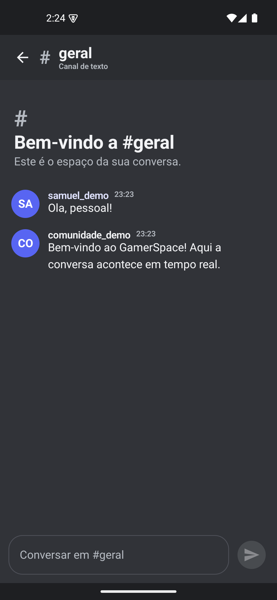
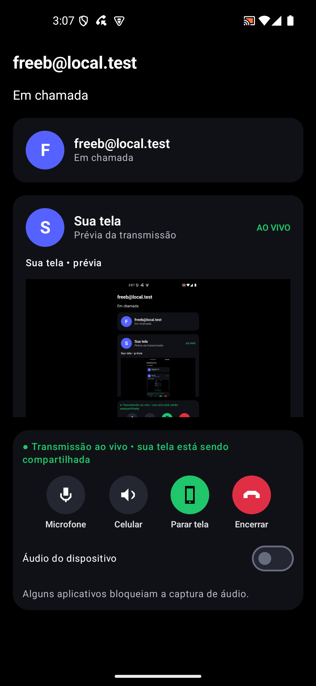

# SamusChat · Android

[← Apresentação do projeto](../README.md) · [Desktop](../samuschat-desktop/README.md) · [API](../chatapp-backend/README.md) · [Documentação](../docs/README.md)

Aplicativo nativo em Kotlin e Jetpack Compose, conectado à mesma API utilizada pela versão para computador. Inclui servidores, canais, mensagens privadas, anexos, chamadas individuais, salas de chamada e compartilhamento de tela.

<p align="center">
  <a href="../docs/images/chat.png"></a>
  <a href="../docs/images/validacao-midia-2026-10-08/screen-local-preview.png"></a>
</p>

## Organização

Compose desenha as telas; ViewModels coordenam estado e ações; repositórios concentram os contratos REST, a sessão e a comunicação. As dependências são fornecidas por um container na aplicação e factories de ViewModel.

| Área | Implementação |
| --- | --- |
| Interface | Jetpack Compose, navegação Servidores / Amigos / Perfil |
| Dados | Retrofit, OkHttp e Coroutines |
| Sessão | JWT e DataStore privado ao aplicativo |
| Tempo real | STOMP/WebSocket, atualização por ID e histórico paginado |
| Chamadas | WebRTC, microfone, transmissão e recepção da tela |
| Notificações | Firebase Messaging opcional |

As conversas reais utilizam a API. A tela Amigos separa amizades aceitas, solicitações recebidas/enviadas e busca de pessoas por nome ou ID público completo. Membros de servidores não são adicionados automaticamente. Os convites são sincronizados com a versão web; a lista é atualizada enquanto a tela está aberta. As imagens do perfil são sincronizadas com o backend.

## Abrir e executar

Pré-requisitos: Android Studio, JDK 17 ou 21, SDK Android 35 e Build Tools 34.0.0. O aplicativo requer **Android 8.0/API 26 ou superior**. Configure `ANDROID_HOME` ou `sdk.dir` no arquivo local `local.properties`.

O APK usa por padrão `https://samuschat-beta.onrender.com/`. Depois da instalação, funciona por Wi-Fi ou dados móveis, sem cabo USB e sem o computador ligado. A conta deve existir nesse servidor; contas e históricos de um banco local não são transferidos automaticamente.

Para desenvolvimento com a API local, informe `-PapiBaseUrl=http://127.0.0.1:8080/` e configure `adb reverse tcp:8080 tcp:8080`. Esse modo exige o computador e o cabo USB. No Android Studio, selecione o celular como destino do Run.

Para usar o launcher que inicia o ambiente e abre o aplicativo, consulte [inicialização automática](../docs/INICIALIZACAO_AUTOMATICA.md).

## Gerar e instalar o APK de desenvolvimento

Na pasta `samuschat-android/`:

```powershell
.\gradlew.bat :app:assembleDebug
```

Saída: `app/build/outputs/apk/debug/app-debug.apk`.

Para desenvolvimento com uma API na rede local, defina o IP da máquina que a executa. O endereço abaixo é um exemplo; substitua pelo IP da sua rede:

```powershell
.\gradlew.bat :app:assembleDebug -PapiBaseUrl=http://192.168.1.9:8080/
adb devices
adb -d install -r app/build/outputs/apk/debug/app-debug.apk
```

O celular precisa estar conectado, com depuração USB autorizada, e conseguir acessar a API. A URL deve terminar com `/`. Para acessar pelo Wi-Fi, os dispositivos precisam de conectividade entre si e a porta da API deve estar acessível. `FILE_BASE_URL` no backend também deve usar um endereço alcançável pelo celular.

HTTP é permitido na variante de desenvolvimento. A distribuição de produção exige API HTTPS e WebSocket WSS; assinatura e hospedagem da beta precisam ser configuradas para a entrega externa.

## Testes e validação

```powershell
.\gradlew.bat :app:testDebugUnitTest :app:lintDebug
```

Regressão de 09/10/2026: **30 testes unitários aprovados**, zero falhas, erros ou ignorados. Lint: **zero erros**, 16 avisos e 1 informação. Consulte o [relatório consolidado](../docs/REGRESSAO_ACEITE_DESKTOP_2026-10-09.md).

A [regressão de mídia e estabilidade de 08/10/2026](../docs/REGRESSAO_MIDIA_ESTABILIDADE_2026-10-08.md) registra 19 cenários em dois emuladores, com capturas da tela transmitida e recebida. Áudio interno depende de Android compatível e da permissão de captura do aplicativo reproduzido. A validação entre desktop e Android e em redes externas ainda precisa de uma rodada específica.

## Integrações opcionais

| Integração | Configuração |
| --- | --- |
| Login Google | Cliente OAuth Android para `com.samuschat`/SHA-1 e Client ID Web correspondente no backend e em `-PgoogleClientId=...` |
| Recuperação por email | SMTP configurado na API |
| Push Firebase | `app/google-services.json` local e credencial de serviço no backend |
| STUN/TURN | Configuração ICE fornecida pela API para chamadas |

O login Google está implementado no Android, mas sua configuração real está pendente. Arquivos locais e credenciais das integrações ficam fora do Git. Veja [autenticação](../docs/AUTENTICACAO.md) e [guia Android](../docs/ANDROID.md).

## Guias detalhados

- [Interface, contratos e configuração Android](../docs/ANDROID.md)
- [Mensagens privadas](../docs/MENSAGENS_PRIVADAS.md)
- [Envio de anexos](../docs/ANEXOS_ANDROID.md)
- [Chamadas individuais, tela e áudio](../docs/CHAMADAS_INDIVIDUAIS.md)
- [Salas de chamada e permissões](../docs/CANAIS_DE_CHAMADA.md)
- [Prévia da tela compartilhada](../docs/PREVIA_COMPARTILHAMENTO.md)
- [Validação de mídia e estabilidade](../docs/REGRESSAO_MIDIA_ESTABILIDADE_2026-10-08.md)
- [Índice completo](../docs/README.md)

Veja [sessão persistente Android](../docs/SESSAO_ANDROID.md): tokens criptografados, renovação automática e diferença entre fechar o app e sair da conta.
Veja [tela cheia e rotação da transmissão](../docs/TELA_CHEIA_ROTACAO_PC_ANDROID.md): tocar na imagem revela o botão central de tela cheia; a captura acompanha jogos e vídeos que mudam a tela para paisagem.
